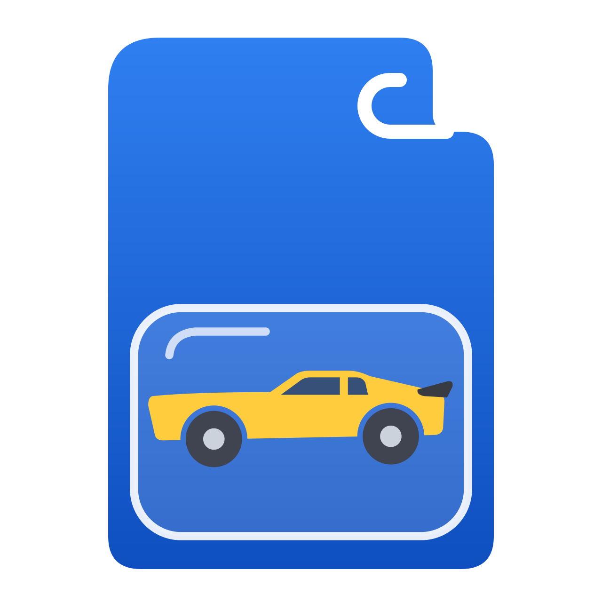
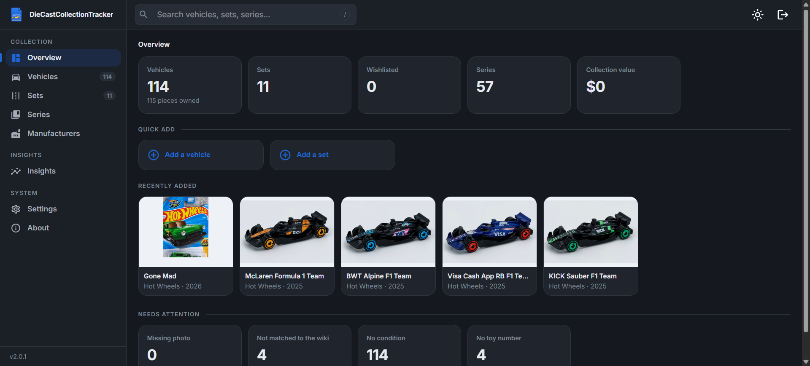
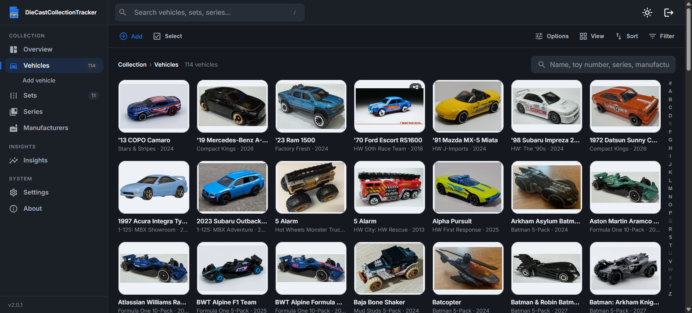
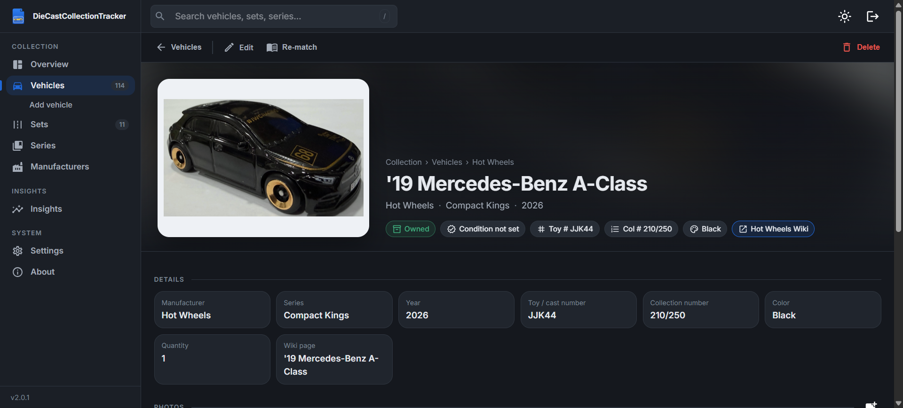
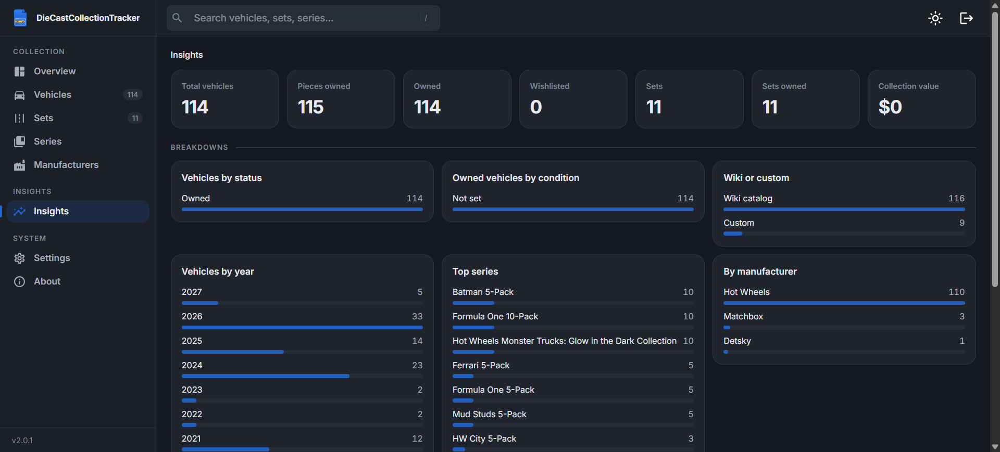
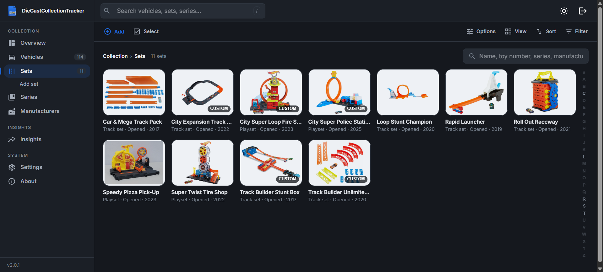
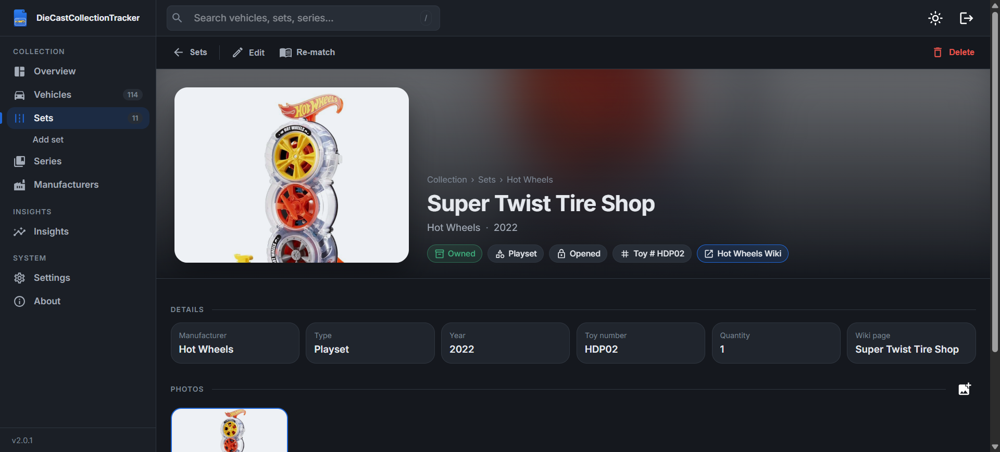
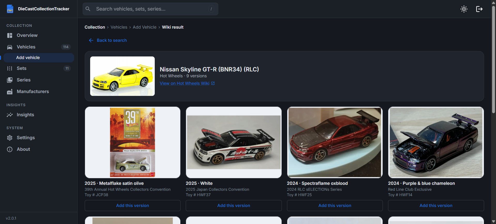

<p align="center">
  
</p>

<h1 align="center">DieCastCollectionTracker</h1>

<p align="center">
  A self-hosted web app for tracking your die-cast collection — what you own, what you want,
  and what it's worth — with photos, filters, and offline browsing.
</p>

<p align="center">
  <a href="https://github.com/wwwescape/DieCastCollectionTracker/releases"></a>
  <a href="https://github.com/wwwescape/DieCastCollectionTracker/commits/master"></a>
  <a href="https://github.com/wwwescape/DieCastCollectionTracker"></a>
</p>

## Screenshots









## Features

- **Collection tracking** — vehicles (cars, bikes, planes, boats and more) you own or have
  wishlisted, with manufacturer, series, vehicle type, color, toy/cast and collection numbers,
  year, condition (Mint in Box to Poor), quantity, purchase price, notes, and tags. Every card
  shows Owned or Wishlisted and how many you have. The Collection page has quick Add Vehicle and
  Add Set buttons.
- **Wiki catalog matching** — find a vehicle on the community [Hot Wheels
  Wiki](https://hotwheels.fandom.com) or [Matchbox Wiki](https://matchbox.fandom.com) by name or
  by the toy number on the card (e.g. `HYW18`), pick the exact release, and the form fills in
  name, series, color, toy and collector numbers, year, and photo. Search results show what you
  already have, and flag castings and series you own vehicles from. Existing vehicles can be
  matched from their edit page. No API key needed; the instance needs outbound internet access.
- **Multi-packs** — 5-Packs, 10-Packs and other multi-packs from the Hot Wheels Wiki show up in
  vehicle search with a pack chip (search by name or the box's toy number, e.g. `JMM24`). Open
  one to see every car in it, untick any you don't want or already have, and add the rest in
  one go, as Owned or Wishlisted, with the pack as their series. Any car can be edited before
  adding instead.
- **Sets** — track playsets and track sets (like Hot Wheels City's fire stations) as single items,
  with series, toy number, year, condition, sealed or opened, tags, and the vehicles that came
  with them. Find a set on the Hot Wheels Wiki by name or toy number (e.g. `FMY96`) to fill it
  in, photo included; Matchbox sets are entered by hand, since that wiki has no page per set.
- **Linked vehicles and sets** — link a set to the vehicles in your collection that came with it,
  from either form. Adding a set from the wiki links the vehicles you already have.
- **Manufacturers** — every manufacturer with its logo (Hot Wheels, Matchbox, Majorette) and
  counts; open one to see all of its vehicles and sets.
- **Series** — every series by year with its counts (a yearly pack like Batman 5-Pack gets
  a card per year); open one to see that year's vehicles and sets.
- **Photo gallery** — several photos per vehicle and set, with a primary photo for the card.
- **Search, filters & bulk actions** — search vehicles and sets by name, toy number, series,
  manufacturer or notes. Filter by status, manufacturer, series, vehicle type, color, condition,
  tags, type, sealed state or source (wiki or custom), each with Exclude, plus Match any/all for
  tags; sort by name, year, date added, quantity or price. Filters are remembered for the session.
  Select several items to remove them, add or remove tags, or set their status, condition or
  series in one go.
- **Your own lookup lists** — manufacturers, series, vehicle types, and colors grow as you type,
  and can be managed in Settings → Lookups.
- **Customizable Overview** — reorder or hide its sections (summary tiles, quick add, recently
  added, wishlist, needs attention); the layout is saved on your account.
- **Insights** — vehicle and set counts, collection value, stats by manufacturer and vehicle type,
  plus recently added vehicles.
- **Share links** — read-only links to your vehicles and sets for people without an account,
  without your purchase prices, notes, or tags. Sharing is off until you turn it on in
  Settings; regenerate the links or turn sharing off to revoke access.
- **Languages and currency** — English, Spanish, French, and Portuguese, and a choice of currency
  for prices, saved on your account for every browser.
- **Backup and restore** — export everything as a .zip with your uploaded photos, or as a
  data-only .json; restore either in one step, after a safety snapshot of the current collection.
- **Danger Zone** — clear notes, tags or purchase prices, remove unused lookups or photo files,
  or reset vehicles, sets or everything (resets need RESET typed and take a safety snapshot first).
- **PWA** — installable, and works offline for anything you've already viewed (photos included).
- **Material 3 design** — light and dark mode, high contrast, a choice of accent colors (the
  logo's blue by default), and responsive navigation for phone, tablet, and desktop.
- **About and update check** — version, links and credits, plus a notice in the top bar when a
  newer release is out on GitHub.
- **Single admin, self-hosted** — no public registration, no multi-tenancy.

## Installation

The published Docker image bundles the frontend and backend into a single container, with
SQLite, so no separate database service is needed. Create a `docker-compose.yml`:

```yaml
services:
  app:
    image: wwwescape/diecastcollectiontracker:latest
    container_name: diecastcollectiontracker
    ports:
      - "8000:8000"
    env_file:
      - .env
    volumes:
      - db-data:/app/backend/db
      - uploads-data:/app/backend/uploads
    restart: unless-stopped

volumes:
  db-data:
  uploads-data:
```

Create a `.env` file next to it (see [Configuration](#configuration)), then start it:

```bash
docker compose up -d
```

Open `http://localhost:8000`. On a fresh instance you'll see a create-admin form instead of the
login screen: fill it in once and you're signed in. Migrations run automatically on startup, and
your database and photos live in the named volumes, so they survive restarts and upgrades.

To change your password, use **Settings → Account → Change password**. It signs out every
other browser and device. Locked out? Reset the password from the CLI:

```bash
docker compose exec app python -m scripts.create_admin --username admin
```

### Upgrading

```bash
docker compose pull && docker compose up -d
```

Running from source instead? `git pull`, reinstall dependencies if they changed, then run
`alembic upgrade head` from `backend/` before starting the app.

## Configuration

Settings live in `.env` (see [.env.example](.env.example)). Only a JWT secret is required:

```env
JWT_SECRET_KEY=            # generate with: python -c "import secrets; print(secrets.token_hex(32))"
```

Optional: `DATABASE_URL` (a local SQLite file by default), `CORS_ORIGINS`, and `APP_PORT`
(`8000` by default, used by the repo's own `docker-compose.yml`).

### Reverse proxy

Sign-in is limited to 5 failed attempts per 15 minutes per client address. Behind a reverse
proxy every request comes from the proxy's address, so let uvicorn trust the proxy's
`X-Forwarded-For` header. Override the container's command with
`uvicorn app.main:app --host 0.0.0.0 --port 8000 --proxy-headers --forwarded-allow-ips=<proxy IP>`.
Serve the app over HTTPS at the proxy, which is also where HSTS belongs. The interactive API docs
(`/docs`) are only available when `ENVIRONMENT=development`; the Docker image runs in production.

## Development

Requires [Git](https://git-scm.com/downloads), [Node.js 22+](https://nodejs.org/en/download/current),
and [Python 3.12+](https://www.python.org/downloads/).

```bash
git clone https://github.com/wwwescape/DieCastCollectionTracker.git
cd DieCastCollectionTracker
npm install
cd backend
python -m venv .venv
.venv\Scripts\activate          # Windows; use `source .venv/bin/activate` on macOS/Linux
pip install -r requirements-dev.txt
alembic upgrade head
```

Create `.env` in the project root as described in [Configuration](#configuration), then run the
backend and frontend in two terminals:

```bash
cd backend && .venv\Scripts\activate && uvicorn app.main:app --reload --port 8000
```

```bash
npm start
```

The frontend runs on `http://localhost:3000` and talks to the backend on
`http://localhost:8000`. The first visit shows the create-admin form, since the database starts
with no users. The repo's own `docker-compose.yml` builds the image from source
(`docker compose up -d --build`).

### Test

```bash
npm run lint && npm run typecheck && npm test && npm run build
cd backend && ruff check . && pytest
```

### Release a new version

```bash
git tag v1.1.0
git push origin v1.1.0
```

The tag push publishes the Docker image to GHCR and Docker Hub (tagged with the version and
`latest`) and creates a GitHub Release. Publishing to Docker Hub needs the `DOCKERHUB_USERNAME`
and `DOCKERHUB_TOKEN` repository secrets.

### Project layout

```
frontend/   TypeScript, Vite, MUI (Material 3), TanStack Query, React Router — own package.json
backend/    FastAPI, SQLAlchemy (SQLite), Alembic, Pydantic, PyJWT — own requirements.txt
docs/       Developer guide
```

See [docs/developer-guide.md](docs/developer-guide.md) for conventions,
[frontend/README.md](frontend/README.md) and [backend/README.md](backend/README.md) for each
half, and [CONTRIBUTING.md](CONTRIBUTING.md) if you're sending a PR.

## License

GPL-3.0 — see [LICENSE](LICENSE).

## Support

If you find DieCastCollectionTracker useful, consider buying me a coffee:

[](https://buymeacoffee.com/wwwescape)
